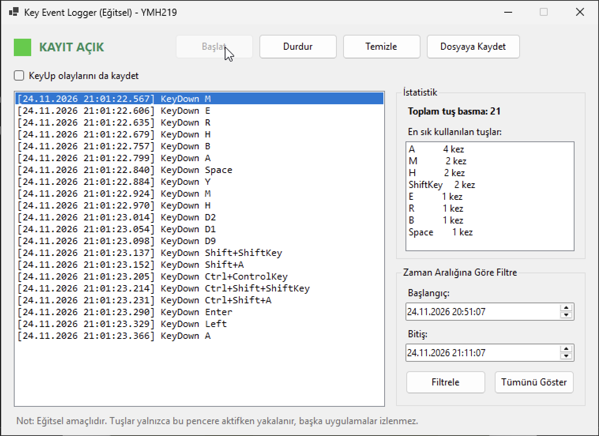
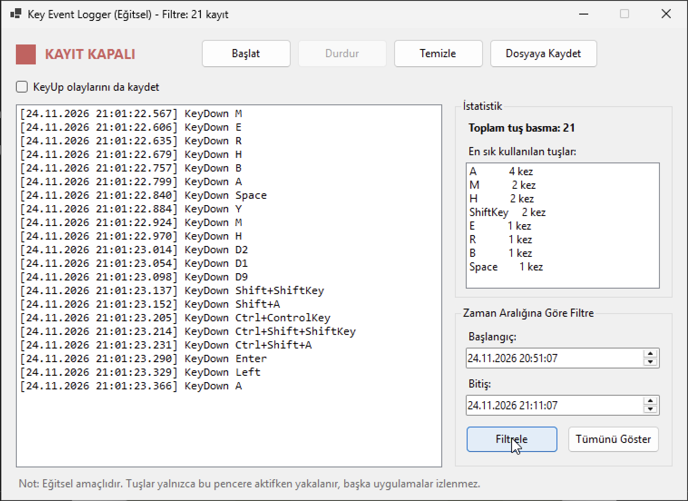

# YMH219 - Key Event Logger (Eğitsel)

Windows Forms'ta klavye olaylarının (`KeyDown`, `KeyUp`) nasıl yakalandığını göstermek için hazırladığım eğitsel bir uygulama. Uygulama **sadece kendi penceresi aktifken** basılan tuşları, zaman bilgisiyle birlikte listeliyor ve istenirse `.txt` dosyasına kaydediyor.

**Öğrenci:** Miraç Özcan AĞCABAY - Öğrenci No: 250541002

> **Güvenlik notu:** Bu uygulama gerçek bir keylogger değildir. Global keyboard hook kullanılmaz, arka planda/gizli çalışmaz, başlangıçta otomatik açılmaz, başka uygulamalardan veri toplamaz ve hiçbir veriyi ağ üzerinden göndermez. Tuşlar yalnızca formun `KeyPreview` özelliği ile, form odaktayken yakalanır.

## Kullanılan Teknolojiler

- C# / .NET 8 (net8.0-windows)
- Windows Forms (`KeyPreview`, `KeyDown`, `KeyUp`)
- `StreamWriter` ile dosya işlemleri
- LINQ (istatistik ve filtreleme)
- Harici NuGet paketi yok

## Proje Yapısı

| Dosya | Açıklama |
|---|---|
| `TusKaydi.cs` | Tek bir tuş olayı: zaman, tuş adı, olay tipi, Ctrl/Alt/Shift bilgisi ve kayıt formatı |
| `KayitYoneticisi.cs` | Kayıt listesini tutar; başlat/durdur, temizle, filtrele, istatistik ve dosyaya kaydetme |
| `Form1.cs` | Arayüz, butonlar ve klavye olayları |

## Kurulum ve Çalıştırma

1. Depoyu klonlayın:
   ```bash
   git clone https://github.com/magcabay/YMH219-KeyEventLogger.git
   ```
2. `KeyEventLogger.sln` dosyasını Visual Studio 2022 ile açın ve `F5` ile çalıştırın.

## Özellikler

- **Başlat / Durdur** butonları ile kayıt kontrolü
- Kayıt durumunu gösteren renkli gösterge (yeşil: KAYIT AÇIK, kırmızı: KAYIT KAPALI)
- Basılan tuşun adı, Ctrl/Alt/Shift kombinasyonu ve milisaniyeli zaman bilgisi ListBox'ta gösteriliyor
- İsteğe bağlı olarak KeyUp olayları da kaydedilebiliyor
- **Temizle** ile ekrandaki kayıtlar siliniyor (onay soruluyor)
- **Dosyaya Kaydet** ile kayıtlar `.txt` dosyasına yazılıyor
- Toplam tuş basma sayısı ve en sık kullanılan 8 tuş istatistiği
- Başlangıç–bitiş zamanına göre filtreleme (filtre açıkken kaydetme sadece filtrelenmiş kayıtları yazar)

Örnek kayıt satırı:
```
[24.11.2026 21:15:42.318] KeyDown Ctrl+Shift+A
```

## Ekran Görüntüleri





## Bilinen Sınırlamalar / Geliştirme Notları

- `Tab` gibi bazı tuşlar Windows Forms tarafından odak değiştirmek için kullanıldığından KeyDown olayına düşmeyebilir.
- Türkçe karakterler `Keys` enum adıyla görünüyor (ör. `ş` tuşu `Oem1` gibi). İleride `KeyPress` ile karakter karşılığı da gösterilebilir.
- Kayıtlar sadece bellekte tutuluyor, uygulama kapanınca kaydedilmemiş kayıtlar kayboluyor.
